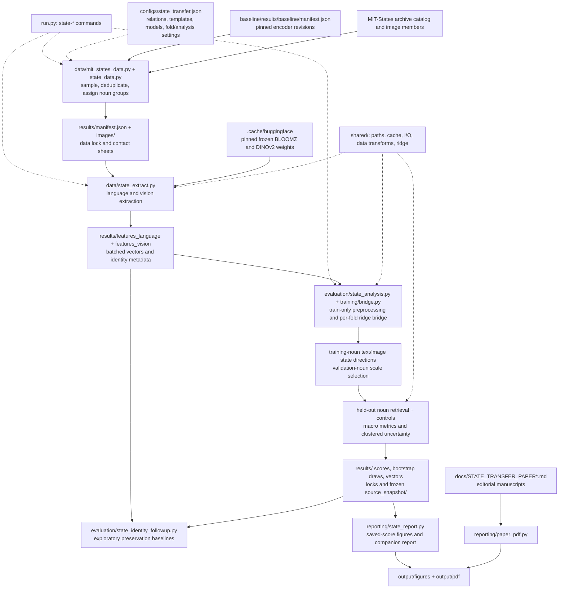
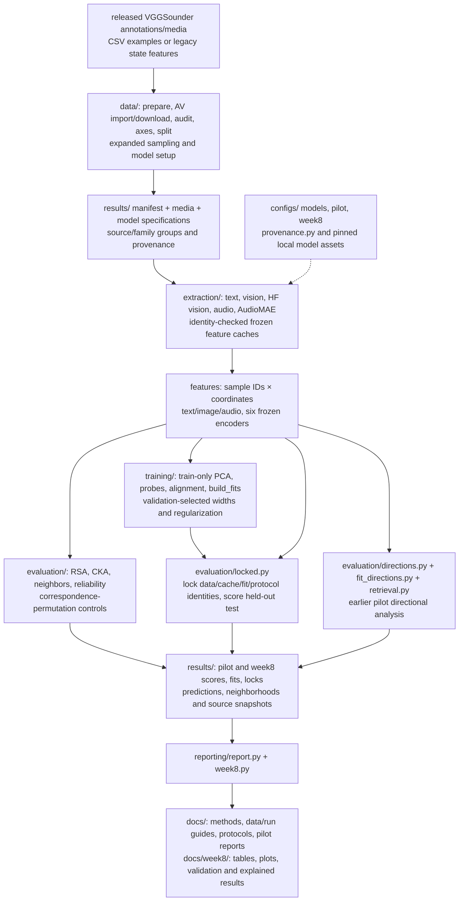
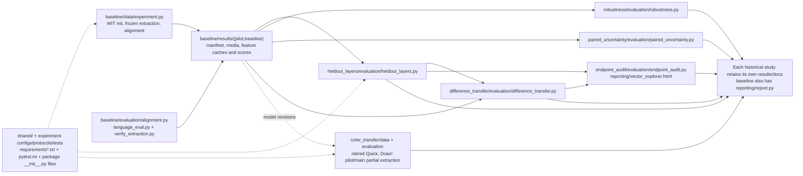

# GUIDE: files and data flow

Start at [the experiment index](../README.md). Read [current direction](../CURRENT_DIRECTION.md) for research status, [the detailed code guide](../CODE_GUIDE.md) for state-transfer implementation, and [the file inventory](FILE_INVENTORY.md) to locate every maintained file and every local artifact group.

The two state-transfer tracks are [future work only](planning/STATE_RELATIONS_PLAN.md). The diagrams below show the code and artifacts that exist today. They do not imply an implemented adaptive-strength method or new family-held-out benchmark.

## Where every kind of file belongs

```text
sz684/
  README.md                    entry point, study status and commands
  CURRENT_DIRECTION.md         current questions and planned work
  CODE_GUIDE.md                detailed completed state-transfer walkthrough
  run.py                      historical/state study command dispatcher
  pytest.ini                  test discovery
  requirements*.txt           base, analysis and recorded environment specs
  docs/
    GUIDE.md          this guide and diagrams
    FILE_INVENTORY.md          maintained-file index + artifact group coverage
    CLEANUP_RECORD.md          deletions, moves and preservation checks
    planning/                 current follow-up plan (no implementation)
    history/                  superseded plans and cross-study reviews
  shared/                     paths, I/O, transforms, cache checks, ridge solver
    tests/                    shared behavior checks
  experiments/
    state_transfer/           completed natural state-change reference study
    multimodal_structure/    exploratory text/image/audio geometry and CAVs
    baseline/                 historical WIT data, features and alignment
    heldout_layers/           historical held-out layer selection
    robustness/               historical sensitivity analyses
    paired_uncertainty/       historical conditional inference
    difference_transfer/     historical arbitrary endpoint differences
    endpoint_audit/           historical endpoint audit and vector explorer
    color_transfer/           retired red-to-blue work; partial artifacts kept
  .cache/                     downloaded weights/datasets and runtime caches
  .venv/                      installed runtime, not project source
```

Within an experiment, `data/` prepares records and manifests; `extraction/` contains separate frozen-model adapters where present; `training/` fits small maps/probes; `evaluation/` scores queries and controls; `reporting/` renders saved scores; `configs/` specifies settings; `docs/` stores protocols and interpretation; `tests/` checks software behavior. `__init__.py` files define Python packages.

`results/` is ignored by Git and contains local media, feature caches, fits, locks, scores, source snapshots and, in the multimodal study, downloaded third-party encoder assets. `output/` stores rendered state-study figures/PDFs. Multimodal compact reports currently live in `docs/` and `docs/week8/`; those are retained in place to preserve links and reproduction commands. Rendered files and source snapshots are intentional records, not duplicate code to edit.

## Completed state-transfer pipeline

Solid arrows carry inputs/results. Dashed arrows provide settings or shared support. Encoders stay frozen; the ridge translator and preprocessing are fitted separately for each held-out fold.



For example, “raw → cooked” is averaged over training nouns in text, mapped into image coordinates, then added to a held-out source-image embedding with a validation-selected scale. Retrieval evaluates both requested state and noun retention. The photographs are independent images, not physical before/after pairs. Read [CODE_GUIDE.md](../CODE_GUIDE.md) for array shapes, gallery exclusions and inference limits.

The completed study improves joint retrieval but fails its preservation guardrail. Existing constrained scaling and identity-subspace projection are exploratory follow-ups, not the proposed source-dependent method.

## Existing multimodal pipeline

This study has a separate runner: `python -m experiments.multimodal_structure.run`. Its metrics concern shared concept geometry and category classifiers, not verified object-state changes.



Latest reading order: [week-8 results](../experiments/multimodal_structure/docs/week8/RESULTS.md), [worked explanations and chance baselines](../experiments/multimodal_structure/docs/week8/RESULTS_EXPLAINED.md), [validation limits](../experiments/multimodal_structure/docs/week8/VALIDATION.md), then [reproduction guide](../experiments/multimodal_structure/docs/WEEK8_RUN_GUIDE.md). The earlier pilot remains distinct from the larger study. Uncertainty/refitting, multiplicity and fresh-source replication are subsequent work.

## Historical dependencies and supporting files



The baseline feature loader is imported by historical evaluation modules. State data creation also reads the baseline manifest. `shared/paths.py` resolves older saved names, and `shared/extractor_migrations.json` pins accepted historical extractor hashes. Removing these because their names look old would break reproduction.

Environment files, tests and documentation support the pipelines rather than carrying empirical observations. Synthetic fixtures are software checks, not research findings. The inventory lists each maintained file individually; ignored runtime and artifact trees are counted as recursive groups so that thousands of media/installed-library files do not obscure the explanation.
