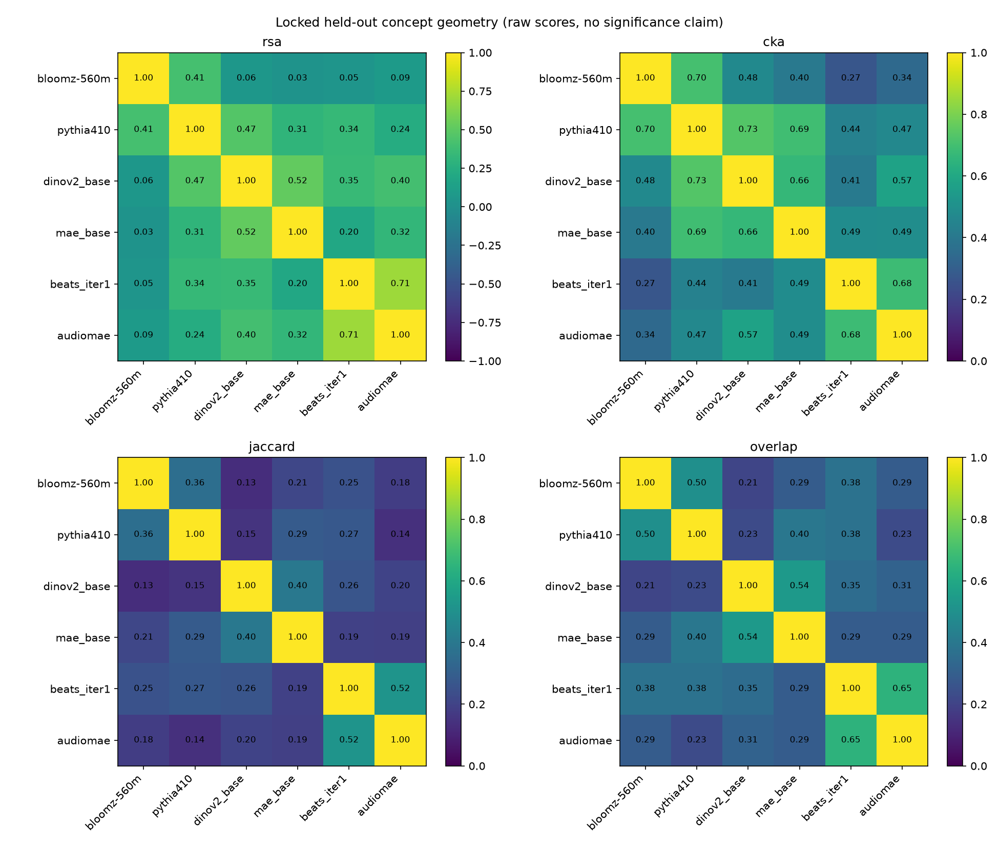
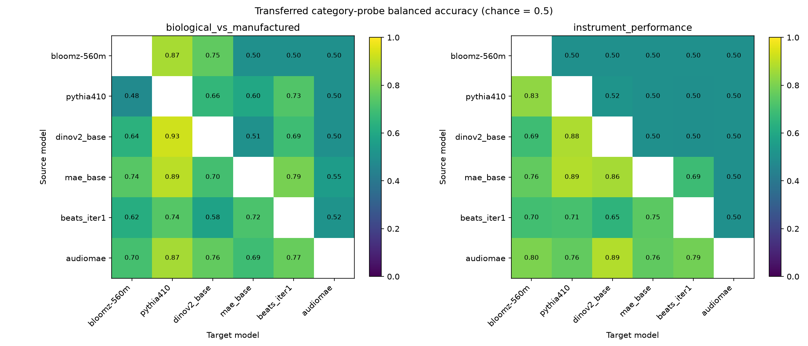

# Week 8: locked held-out released-label results

Completed computational evaluation under the approved released-label scope. No encoder was fine-tuned.

Data: 80 concepts, 1200 paired recordings, 320 text descriptions. Concept split: {'train': 50, 'validation': 14, 'test': 16}.
Models: 6; geometry pairs: 15; ordered category-axis tests: 60.

## Geometry on held-out concepts

| Pair | RSA | CKA | Jaccard | Top-3 overlap |
| --- | ---: | ---: | ---: | ---: |
| bloomz-560m / pythia410 | 0.4106 | 0.7047 | 0.3625 | 0.5000 |
| bloomz-560m / dinov2_base | 0.0607 | 0.4751 | 0.1312 | 0.2083 |
| bloomz-560m / mae_base | 0.0303 | 0.4027 | 0.2125 | 0.2917 |
| bloomz-560m / beats_iter1 | 0.0467 | 0.2687 | 0.2500 | 0.3750 |
| bloomz-560m / audiomae | 0.0930 | 0.3399 | 0.1813 | 0.2917 |
| pythia410 / dinov2_base | 0.4653 | 0.7334 | 0.1500 | 0.2292 |
| pythia410 / mae_base | 0.3107 | 0.6944 | 0.2875 | 0.3958 |
| pythia410 / beats_iter1 | 0.3400 | 0.4378 | 0.2750 | 0.3750 |
| pythia410 / audiomae | 0.2362 | 0.4680 | 0.1375 | 0.2292 |
| dinov2_base / mae_base | 0.5182 | 0.6648 | 0.4000 | 0.5417 |
| dinov2_base / beats_iter1 | 0.3467 | 0.4092 | 0.2625 | 0.3542 |
| dinov2_base / audiomae | 0.4048 | 0.5746 | 0.2000 | 0.3125 |
| mae_base / beats_iter1 | 0.1972 | 0.4870 | 0.1937 | 0.2917 |
| mae_base / audiomae | 0.3229 | 0.4899 | 0.1875 | 0.2917 |
| beats_iter1 / audiomae | 0.7094 | 0.6848 | 0.5188 | 0.6458 |

Test concepts: 16; random top-3 overlap expectation: 0.2000.
CKA and RSA have different scales and finite-sample behavior. Full correspondence nulls are saved; unadjusted p-values do not establish significance.

## Category CAV transfer

The table averages fixed-fit scores across model directions in each comparison. It does not treat those directions as independent training replications.

| Comparison | Axis | Maps | Transferred BA | Target probe BA | Shuffled anchors BA | Signed CAV cosine |
| --- | --- | ---: | ---: | ---: | ---: | ---: |
| audio-text | biological_vs_manufactured | 8 | 0.6449 | 0.7909 | 0.5361 | 0.6789 |
| audio-text | instrument_performance | 8 | 0.6207 | 0.8189 | 0.5709 | 0.6399 |
| audio-vision | biological_vs_manufactured | 8 | 0.6599 | 0.7867 | 0.5056 | 0.5682 |
| audio-vision | instrument_performance | 8 | 0.6528 | 0.7733 | 0.5090 | 0.5898 |
| text-vision | biological_vs_manufactured | 8 | 0.7149 | 0.7648 | 0.4888 | 0.5234 |
| text-vision | instrument_performance | 8 | 0.6531 | 0.7887 | 0.5924 | 0.7391 |
| within-audio | biological_vs_manufactured | 2 | 0.6420 | 0.8038 | 0.4420 | 0.6251 |
| within-audio | instrument_performance | 2 | 0.6431 | 0.8139 | 0.4514 | 0.5862 |
| within-text | biological_vs_manufactured | 2 | 0.6733 | 0.8352 | 0.5185 | 0.5380 |
| within-text | instrument_performance | 2 | 0.6667 | 0.8698 | 0.5260 | 0.6728 |
| within-vision | biological_vs_manufactured | 2 | 0.6038 | 0.6973 | 0.5492 | 0.3813 |
| within-vision | instrument_performance | 2 | 0.6819 | 0.7722 | 0.5139 | 0.7799 |

BA means balanced accuracy; binary chance is 0.5. All individual scores, sample/class counts and selected dimensions are exported to category_scores.csv.

## What was locked

- Sampling and backup order were saved before new feature extraction; first-pilot concepts and sources were excluded.
- The initial provisional family plan and pre-extraction corrections remain saved. Three silent files were replaced without consulting model scores.
- Training map-anchor sources and probe sources are disjoint. Test families do not fit transforms, maps, probes or hyperparameters.
- Width and probe regularization were selected on validation only. Every fitted array and selection curve is saved.
- Fit, data, cache, protocol and software hashes were locked before test scoring. Per-example predictions and per-concept neighborhoods are preserved.

## Interpretation and remaining work

- Labels are released video-level AV annotations. The selected stills were decoded but not independently relabeled.
- Category axes are explicit researcher groupings of released event names. They are not physical state changes; noun preservation is not a meaningful metric for these category classifiers.
- Text inputs include event names and therefore provide explicit category cues. Cross-modal differences can reflect this information asymmetry.
- Family grouping is provisional. Unique source IDs and exact-hash checks do not prove uploader independence or pretraining exclusion.
- These are fixed-fit held-out scores. Refit confidence intervals, multiplicity-adjusted decisions and fresh-source replication remain for weeks 9–10.
- Historical image–text object-state retrieval, including identity-retention results, remains a separate exploratory arm; no audiovisual state-change success is claimed.

## Files

- `geometry_scores.csv`: all 15 unordered model pairs.
- `category_scores.csv`: all 60 ordered category-axis comparisons, including controls and sample counts.
- `concepts_and_axes.csv`: every concept, family, split and category-axis label.
- Local run folder: sampling/QA logs, features, `week7_fits.json`, `week7_reliability.json`, `evaluation_lock.json`, `week8_test.json`, `week8_test_predictions.csv`, and geometry detail/null files.

Dataset identity: `7f7d6c32fd0ffd6766cf5b12ac27115e849aeea56fc37be9651dab057cde38ba`.
Evaluation lock SHA256: `83f2b63601eb876b76f78e90ae63d058c61440568a577bdcc318513ee0833c89`.
